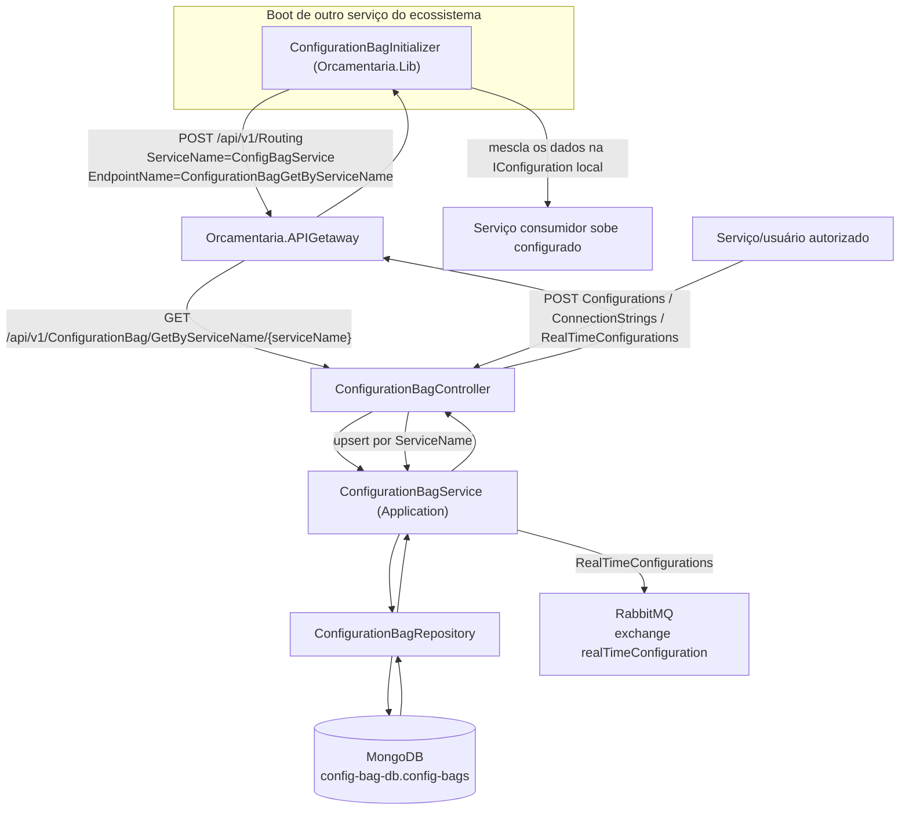
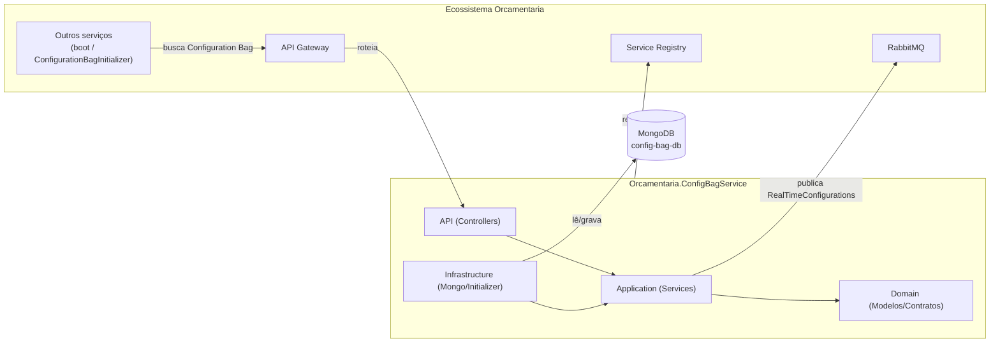
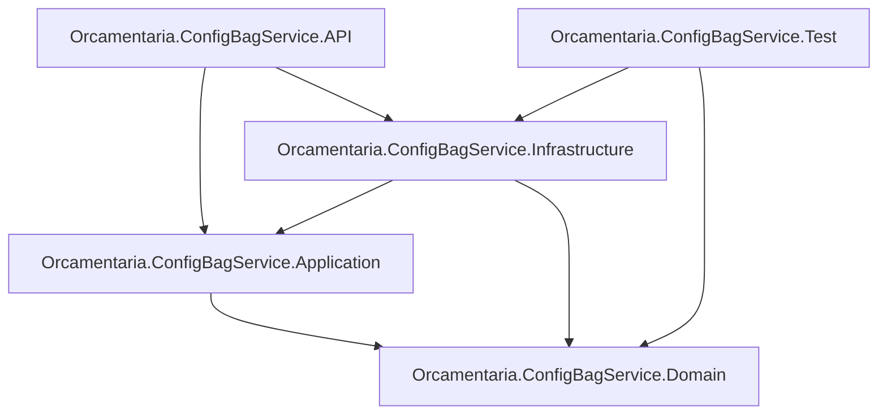

# 🗄️ Orcamentaria.ConfigBagService

Serviço de configuração centralizada do ecossistema **Orcamentaria**, responsável por armazenar e distribuir a **Configuration Bag** (pacote de configuração) de cada serviço — connection strings, configurações estáticas e configurações em tempo real — persistidas em **MongoDB** e consumidas pelos demais serviços através do **API Gateway**.

---

## 🎯 Objetivo

Em vez de cada serviço do ecossistema manter suas próprias connection strings e configurações espalhadas em `appsettings.json`, o `Orcamentaria.ConfigBagService` centraliza esses dados em um único lugar:

1. Cada serviço possui um documento próprio — a **Configuration Bag** — identificado pelo seu `ServiceName`, contendo `ConnectionStrings`, `Configurations` e `RealTimeConfigurations`.
2. No boot, cada serviço do ecossistema (via `Orcamentaria.Lib.Infrastructure.Initializers.ConfigurationBagInitializer`) chama o endpoint `ConfigurationBagGetByServiceName` deste serviço **através do API Gateway**, buscando sua Configuration Bag e mesclando-a à configuração local (`IConfiguration`) antes de subir os demais serviços da aplicação.
3. Administradores/serviços autorizados publicam ou atualizam essas configurações através dos endpoints de escrita do `ConfigurationBagController`.
4. Atualizações de `RealTimeConfigurations` são também publicadas em uma exchange do RabbitMQ, permitindo que os serviços interessados reajam a mudanças de configuração sem reiniciar.

O próprio `Orcamentaria.ConfigBagService` também usa o conceito de Configuration Bag para se configurar, mas com uma inicialização própria (`Orcamentaria.ConfigBagService.Infrastructure.Initializers.ConfigurationBagInitializer`) que consulta o MongoDB diretamente — já que, sendo a fonte da configuração dos demais serviços, ele não pode depender do API Gateway para obter a própria configuração no boot.

---

## 🧰 Tecnologias

| Tecnologia | Versão | Finalidade |
|---|---|---|
| C# / .NET | 9 | Linguagem e runtime da aplicação |
| ASP.NET Core Web API | `Microsoft.NET.Sdk.Web` | Hospedagem HTTP |
| MongoDB.Driver | 3.5.0 | Persistência da Configuration Bag no MongoDB |
| AutoMapper | 15.1.0 | Mapeamento entre `ConfigurationBag` (Domain) e `ConfigurationBagResponseDTO` (Lib) |
| FluentValidation | 12.1.0 | Referenciado no Domain e na Application |
| `Orcamentaria.Lib.Domain` | 10.1.1 | Modelos, DTOs, exceptions e contratos compartilhados do ecossistema |
| `Orcamentaria.Lib.Infrastructure` | 5.4.0 | Composição de serviços comuns (autenticação, Swagger, CORS, mensageria, Service Registry) |
| `Orcamentaria.Lib.Application` | 2.1.4 | Implementações compartilhadas (HTTP client, API Gateway client, tokens) |
| xUnit / Moq / FluentAssertions / Bogus (via `Orcamentaria.Lib.Test`) | — | Stack de testes unitários (`Orcamentaria.ConfigBagService.Test`) |

---

## 🏗️ Arquitetura

O projeto segue uma **arquitetura em camadas**, apoiada na biblioteca interna compartilhada `Orcamentaria.Lib`:

- **Domain**: modelo `ConfigurationBag`, DTOs de inserção, contratos (`IConfiguirationBagRepository`, `IConfiguirationBagService`), mapeamento AutoMapper e enum `EnvironmentEnum`.
- **Application**: `ConfigurationBagService`, orquestra leitura/gravação da Configuration Bag e publicação de eventos de configuração em tempo real.
- **Infrastructure**: `MongoContext` (acesso ao MongoDB), `ConfigurationBagRepository` e o `ConfigurationBagInitializer` usado pelo próprio serviço para se autoconfigurar no boot.
- **API**: `ConfigurationBagController`, `Startup.cs` (composição de injeção de dependência) e chaves públicas RSA para validação de token.

Fluxo de dependência entre camadas: `API → Application → Domain`, com `Infrastructure` implementando os contratos definidos no Domain.

---

## 📁 Estrutura do Projeto

```text
Orcamentaria.ConfigBagService/
├── Orcamentaria.ConfigBagService.API/
│   ├── Controllers/v1/ConfigurationBagController.cs   # Endpoints de leitura e escrita da Configuration Bag
│   ├── Keys/                                          # Chaves públicas RSA para validação de token
│   ├── Program.cs / Startup.cs                        # Bootstrap e injeção de dependências
│   └── appsettings*.json                              # Configuração de boot (Mongo + API Gateway)
├── Orcamentaria.ConfigBagService.Application/
│   └── Services/ConfigurationBagService.cs            # Regras de leitura/gravação da Configuration Bag
├── Orcamentaria.ConfigBagService.Domain/
│   ├── DTOs/ConfigurationBag/*.cs                     # DTOs de entrada dos endpoints de escrita
│   ├── Enums/EnvironmentEnum.cs
│   ├── Mappers/ConfigurationBagMapper.cs              # ConfigurationBag <-> ConfigurationBagResponseDTO
│   ├── Models/ConfigurationBag.cs                     # Documento persistido no MongoDB
│   ├── Repositories/IConfiguirationBagRepository.cs
│   └── Services/IConfiguirationBagService.cs
├── Orcamentaria.ConfigBagService.Infrastructure/
│   ├── Contexts/MongoContext.cs                       # Conexão com o banco "config-bag-db" / coleção "config-bags"
│   ├── Initializers/ConfigurationBagInitializer.cs    # Autoconfiguração do próprio serviço via MongoDB direto
│   └── Repositories/ConfigurationBagRepository.cs
├── Orcamentaria.ConfigBagService.Test/                # Testes unitários (xUnit + Moq + FluentAssertions)
│   ├── Contexts/MongoContextTest.cs
│   ├── Fixtures/ConfigurationBagFixture.cs
│   └── Repositories/ConfigurationBagRepositoryTest.cs
└── Orcamentaria.ConfigBagService.sln
```

---

## 🔄 Fluxo da Aplicação



**Passo a passo:**
1. Um serviço do ecossistema, ao iniciar, chama o API Gateway pedindo o recurso `ConfigBagService` / `ConfigurationBagGetByServiceName`, passando seu próprio nome como parâmetro de rota (`serviceName`).
2. O Gateway roteia a chamada até `GET /api/v1/ConfigurationBag/GetByServiceName/{serviceName}` deste serviço.
3. `ConfigurationBagService.GetConfiguirationBagByServiceName` busca o documento correspondente no MongoDB via `ConfigurationBagRepository` e o mapeia para `ConfigurationBagResponseDTO`.
4. O serviço consumidor mescla os valores retornados (`ConnectionStrings`, `Configurations`, `RealTimeConfigurations`) na sua `IConfiguration` local antes de finalizar o boot.
5. Para gravação, um chamador autorizado envia `POST` para `Configurations`, `ConnectionStrings` ou `RealTimeConfigurations`, informando o `ServiceName`; o serviço busca a Configuration Bag existente (ou cria uma nova) e faz upsert no MongoDB.
6. Ao gravar `RealTimeConfigurations`, o serviço também publica o novo conteúdo na exchange `realTimeConfiguration` do RabbitMQ, com routing key `realTimeConfiguration.{ServiceName}`, permitindo que o serviço-alvo reaja em tempo real.

---

## 📦 Dependências principais

| Biblioteca | Uso no projeto |
|---|---|
| `Orcamentaria.Lib.Domain` | `ConfigurationBagResponseDTO`, `Response<T>`, exceptions de domínio (`DefaultException`, `UnexpectedException`, `DatabaseException`, `ConfigurationException`), contratos de mensageria. |
| `Orcamentaria.Lib.Application` | `ApiGetawayService` (usado por outros serviços para rotear até este via Gateway), `HttpClientService`. |
| `Orcamentaria.Lib.Infrastructure` | `ResolveCommonServices`/`ConfigureCommon` em `Startup.cs`, autenticação JWT, Swagger, CORS, publicação/consumo de RabbitMQ, `ServiceRegistryHostedService`. |
| `MongoDB.Driver` | Cliente e coleção MongoDB usados por `MongoContext` e `ConfigurationBagRepository`. |
| `AutoMapper` | Conversão entre o documento `ConfigurationBag` e o DTO de resposta público (`ConfigurationBagResponseDTO`). |

---

## ⚙️ Configuração

A aplicação usa o modelo padrão de configuração do ASP.NET Core (`appsettings.json` + `appsettings.{Environment}.json` + variáveis de ambiente), mas apenas com o mínimo necessário para o **bootstrap**:

**`Orcamentaria.ConfigBagService.API/appsettings.json`:**
```json
{
  "Logging": {
    "LogLevel": {
      "Default": "Information",
      "Microsoft.AspNetCore": "Warning"
    }
  },
  "ConnectionStrings": {
    "DefaultConnection": "<string de conexão do MongoDB>"
  },
  "ApiGetawayConfiguration": {
    "BaseUrl": "https://localhost:44385"
  },
  "AllowedHosts": "*"
}
```

- **`ConnectionStrings.DefaultConnection`**: string de conexão com o cluster MongoDB onde as Configuration Bags são armazenadas (coleção `config-bags`, banco `config-bag-db`).
- **`ApiGetawayConfiguration.BaseUrl`**: endereço do API Gateway.

No `Startup.ConfigureServices`, antes de registrar os demais serviços, o `ConfigurationBagInitializer` (Infrastructure) conecta-se diretamente ao MongoDB usando `ConnectionStrings:DefaultConnection`, busca a própria Configuration Bag (documento cujo `ServiceName` é `Orcamentaria.ConfigBagService`) e mescla o restante das configurações (como `ServiceRegistryConfiguration` e `MessageBrokerConfiguration`) na `IConfiguration` da aplicação antes de prosseguir com `AddServiceRegistryHosted` e `ResolveCommonServices`.

**`Orcamentaria.ConfigBagService.API/appsettings.Development.json`:** contém apenas overrides de `Logging` para o ambiente de desenvolvimento.

---

## 🔑 Variáveis de Ambiente

| Variável | Descrição |
|---|---|
| `ASPNETCORE_ENVIRONMENT` | Define o ambiente ASP.NET Core (default `Development` via `launchSettings.json`). |
| `ConnectionStrings__DefaultConnection` | String de conexão com o MongoDB usada no bootstrap do próprio serviço. |
| `ApiGetawayConfiguration__BaseUrl` | URL do API Gateway (default `https://localhost:44385`). |

Demais chaves de configuração do serviço (Service Registry, RabbitMQ, etc.) são resolvidas dinamicamente a partir da própria Configuration Bag armazenada no MongoDB, e não de variáveis de ambiente locais.

---

## 🗃️ Banco de Dados

- **MongoDB**, banco `config-bag-db`, coleção `config-bags`.
- Documento persistido (`ConfigurationBag`): `_id` (ObjectId), `ServiceName`, `UpdateAt`, `ConnectionStrings` (lista de dicionários chave/valor), `Configurations` (lista de dicionários chave/`BsonDocument`) e `RealTimeConfigurations` (lista de dicionários chave/valor).
- `ConfigurationBagRepository.Save` faz `ReplaceOneAsync` com `IsUpsert = true`, filtrando por `ServiceName` — ou seja, cada serviço tem no máximo um documento de Configuration Bag, atualizado por seção (`Configurations`, `ConnectionStrings` ou `RealTimeConfigurations`) a cada chamada de escrita.

---

## Configuração local

Nenhum valor real deve existir nos arquivos versionados. Configure via `dotnet user-secrets` ou variáveis de ambiente:

```bash
dotnet user-secrets init --project Orcamentaria.ConfigBagService.API
dotnet user-secrets set "ConnectionStrings:DefaultConnection" "__SET_BY_ENV__" --project Orcamentaria.ConfigBagService.API
# substitua __SET_BY_ENV__ pela connection string real do MongoDB Atlas
```

Ou crie `Orcamentaria.ConfigBagService.API/appsettings.Development.json` (já ignorado pelo `.gitignore`) com os valores locais. Nunca commite esse arquivo.

---

## ▶️ Como Executar

### Pré-requisitos
- [.NET SDK 9.0](https://dotnet.microsoft.com/download)
- Acesso a um cluster/instância MongoDB configurado em `ConnectionStrings:DefaultConnection`
- API Gateway e Service Registry acessíveis (para os demais serviços do ecossistema buscarem suas Configuration Bags através deste serviço)
- Já existir uma Configuration Bag para `Orcamentaria.ConfigBagService` no MongoDB (usada pelo próprio `ConfigurationBagInitializer` no boot)

### Passo a passo

```bash
git clone <url-do-repositorio>
cd Orcamentaria.ConfigBagService

dotnet restore
dotnet build

dotnet run --project Orcamentaria.ConfigBagService.API
```

A API sobe, por padrão, em `http://localhost:52302` (perfil HTTPS: `https://localhost:52301`), abrindo automaticamente o navegador em `/swagger`.

---

## 🧪 Como Rodar Testes

O projeto de testes (`Orcamentaria.ConfigBagService.Test`) usa **xUnit**, **Moq** e **FluentAssertions**/**Bogus** (disponibilizados via `Orcamentaria.Lib.Test`).

```bash
dotnet test
```

**Cobertura por classe testada:**

| Classe testada | Cenários cobertos |
|---|---|
| `ConfigurationBagRepository` | `GetAll` com dados retornados e propagação de `DatabaseException` em caso de falha na consulta ao MongoDB |

O projeto conta ainda com fixtures (`ConfigurationBagFixture`, via `Orcamentaria.Lib.Test.Fixtures.BaseFixture`) que geram entidades `ConfigurationBag` de teste com dados fake (Bogus) e simulam o cursor assíncrono do driver MongoDB para os demais cenários de repositório.

---

## 🧭 APIs

### Swagger / OpenAPI
O Swagger está habilitado em ambiente de desenvolvimento, acessível em `/swagger`.

### Endpoints

| Método | Rota | Roles exigidas | Descrição |
|---|---|---|---|
| `GET` | `/api/v1/ConfigurationBag/GetByServiceName/{serviceName}` | `MASTER`, `CONFIGURATION_BAG:READ` | Retorna a Configuration Bag completa do serviço informado. |
| `GET` | `/api/v1/ConfigurationBag/GetConfigurationBagServiceName` | `MASTER`, `CONFIGURATION_BAG:READ` | Retorna a lista de nomes de serviços que possuem Configuration Bag cadastrada. |
| `POST` | `/api/v1/ConfigurationBag/Configurations` | `MASTER`, `CONFIGURATION_BAG:INSERT:CONFIGURATIONS` | Grava/atualiza a seção `Configurations` da Configuration Bag do serviço informado no corpo. |
| `POST` | `/api/v1/ConfigurationBag/ConnectionStrings` | `MASTER`, `CONFIGURATION_BAG:INSERT:CONNECTIONSTRINGS` | Grava/atualiza a seção `ConnectionStrings` da Configuration Bag do serviço informado no corpo. |
| `POST` | `/api/v1/ConfigurationBag/RealTimeConfigurations` | `MASTER`, `CONFIGURATION_BAG:INSERT:REALTIMECONFIGURATIONS` | Grava/atualiza a seção `RealTimeConfigurations` e publica o novo conteúdo no RabbitMQ para o serviço-alvo. |

---

## 🔗 Integrações

| Integração | Descrição |
|---|---|
| **API Gateway** | Ponto de entrada usado pelos demais serviços do ecossistema para consultar `ConfigurationBagGetByServiceName` e buscar sua própria Configuration Bag no boot. |
| **MongoDB** | Armazenamento persistente das Configuration Bags (`config-bag-db.config-bags`). |
| **RabbitMQ** | Publicação de atualizações de `RealTimeConfigurations` na exchange `realTimeConfiguration` (routing key `realTimeConfiguration.{ServiceName}`), permitindo que os serviços reajam a mudanças de configuração sem reiniciar. Também usado pela infraestrutura compartilhada para eventos de erro. |
| **Service Registry** | O serviço se registra via `AddServiceRegistryHosted`/`ServiceRegistryHostedService`, tornando-se descobrível pelo API Gateway. |

---

## 📈 Logs

Logging via `Microsoft.Extensions.Logging`, configurado em `appsettings.json`:

```json
"Logging": {
  "LogLevel": {
    "Default": "Information",
    "Microsoft.AspNetCore": "Warning"
  }
}
```

---

## 🚨 Tratamento de Erros

As camadas de Application e Infrastructure padronizam o tratamento de exceptions:
- `ConfigurationBagRepository` encapsula qualquer falha de acesso ao MongoDB em `DatabaseException`.
- `ConfigurationBagService` repropaga exceptions de domínio (`DefaultException` e suas derivadas) e encapsula qualquer outra falha inesperada em `UnexpectedException`.
- `ConfigurationBagInitializer` lança `ConfigurationException` quando não consegue obter a própria Configuration Bag no boot.
- A infraestrutura compartilhada (`Orcamentaria.Lib.Infrastructure`) aplica um middleware central (`ErrorHandlingMiddleware`) que formata a resposta de erro em JSON com o código de status apropriado.

---

## 🔐 Segurança

Os endpoints do `ConfigurationBagController` exigem autenticação via **JWT (RS256)** e autorização baseada em **roles** (`[Authorize(Roles = "...")]`), com validação de assinatura feita por chaves públicas RSA embarcadas no serviço (`Keys/public_key_user.pem`, `Keys/public_key_service.pem`). A infraestrutura compartilhada seleciona automaticamente o esquema de validação (usuário, serviço ou bootstrap) com base no conteúdo do token JWT enviado no header `Authorization`.

- Leitura da Configuration Bag (`GetByServiceName`, `GetConfigurationBagServiceName`) exige a role `MASTER` ou `CONFIGURATION_BAG:READ`.
- Cada endpoint de escrita exige uma role específica por tipo de configuração (`CONFIGURATION_BAG:INSERT:CONFIGURATIONS`, `CONFIGURATION_BAG:INSERT:CONNECTIONSTRINGS`, `CONFIGURATION_BAG:INSERT:REALTIMECONFIGURATIONS`), além da role `MASTER`.

---

## 🧩 Padrões Encontrados

| Padrão | Onde aparece |
|---|---|
| **Repository** | `IConfiguirationBagRepository`/`ConfigurationBagRepository` isolam o acesso ao MongoDB por trás de um contrato no Domain. |
| **Dependency Injection** | Serviços registrados via `IServiceCollection` e injetados por construtor em toda a solução. |
| **DTO** | DTOs de inserção (`ConfigurationBagConfigurationInsertDTO`, `ConfigurationBagConnectionStringInsertDTO`, `ConfigurationBagRealTimeConfigurationInsertDTO`) e de resposta (`ConfigurationBagResponseDTO`) separam o contrato de API do modelo persistido. |
| **Mapper (AutoMapper Profile)** | `ConfigurationBagMapper` converte entre o modelo `ConfigurationBag` e o DTO de resposta compartilhado. |
| **Upsert por chave de negócio** | `ConfigurationBagRepository.Save` usa `ReplaceOneAsync` com `IsUpsert = true`, filtrando por `ServiceName`. |
| **Self-bootstrapping Configuration** | O próprio serviço usa um `ConfigurationBagInitializer` local (acesso direto ao MongoDB) para carregar sua configuração completa no boot, enquanto os demais serviços do ecossistema fazem o mesmo através do API Gateway. |

---

## 📊 Diagrama de Arquitetura



---

## 🧱 Dependências entre Módulos



---

## 📝 Resumo Executivo

O **Orcamentaria.ConfigBagService** é o serviço de configuração centralizada do ecossistema Orcamentaria, construído em .NET com ASP.NET Core Web API e MongoDB. Ele mantém, por serviço, uma **Configuration Bag** com `ConnectionStrings`, `Configurations` e `RealTimeConfigurations`, expostas através de quatro endpoints protegidos por autenticação JWT e autorização por roles: dois de leitura (`GetByServiceName`, `GetConfigurationBagServiceName`) e três de escrita, um por tipo de configuração.

Os demais serviços do ecossistema consultam este serviço no boot — sempre através do API Gateway — para montar sua própria configuração dinamicamente, sem depender de segredos hardcoded em `appsettings.json`. O próprio `Orcamentaria.ConfigBagService`, por não poder depender do Gateway para se configurar, resolve sua própria Configuration Bag com uma inicialização que acessa o MongoDB diretamente. Atualizações de configuração em tempo real são propagadas via RabbitMQ, permitindo que os serviços interessados reajam a mudanças sem reiniciar. A solução é organizada em camadas (`API → Application → Domain`, com `Infrastructure` implementando os contratos), apoiada na biblioteca compartilhada `Orcamentaria.Lib`, e conta com testes unitários cobrindo o repositório de acesso ao MongoDB.
